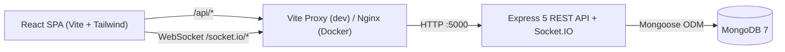

# StayHub — Real-Time Hotel Booking System

Full-stack hotel booking web application built with React, Tailwind CSS, Node.js, Express, MongoDB/Mongoose, JWT authentication with role-based access control, Socket.IO real-time inventory updates, Docker Compose containerization, and GitHub Actions CI/CD.

---

## Architecture Overview



---

## Evaluation Checklist Coverage

| Requirement | Implementation | Key Files |
| --- | --- | --- |
| **1. Frontend with Tailwind** | Responsive layout, sticky navbar, modal workflows, utility-first Tailwind v4 styling | `client/src/index.css`, `client/src/components/Navbar.jsx`, `client/src/components/HotelCard.jsx` |
| **2. React & State Management** | Multi-page SPA (`react-router-dom`), `AuthContext`, `SocketContext`, custom hooks (`useAuth`, `useSocket`, `useHotelRealtimeSync`), search/filter state | `client/src/App.jsx`, `client/src/context/AuthContext.jsx`, `client/src/context/SocketContext.jsx`, `client/src/hooks/` |
| **3. Backend REST API** | Express 5 modular routes/controllers for health, auth, hotel CRUD, search/filter queries, and bookings; centralized error middleware | `server/server.js`, `server/routes/`, `server/controllers/`, `server/middleware/errorMiddleware.js` |
| **4. MongoDB & Mongoose** | `User`, `Hotel`, and `Booking` schemas with references (`ObjectId`), timestamps, atomic `$inc` room decrement on booking, idempotent seed script | `server/config/db.js`, `server/models/`, `server/utils/seed.js` |
| **5. Data Validation** | Mongoose schema validators (`min`, `maxlength`, `enum`, integer checks, date-order check, `availableRooms <= totalRooms`), controller payload validation (`validateAndBuildHotelPayload`), and frontend form checks | `server/models/`, `server/controllers/hotelController.js`, `server/controllers/bookingController.js`, `server/tests/validation.test.js` |
| **6. Authentication & Authorization** | `bcryptjs` password hashing (12 rounds), HS256 JWT signing (`generateToken`), `protect` and `adminOnly` middleware, `ProtectedRoute` UI guards | `server/utils/generateToken.js`, `server/middleware/authMiddleware.js`, `server/controllers/authController.js`, `client/src/components/ProtectedRoute.jsx` |
| **7. Real-Time Features (Socket.IO)** | Live broadcast on `hotel:created`, `hotel:updated`, `hotel:deleted`, `booking:created`, and `booking:cancelled`; real-time `NotificationBell`, live toast alerts, and automatic UI room-count sync | `server/utils/emitSocketEvent.js`, `client/src/context/SocketContext.jsx`, `client/src/hooks/useHotelRealtimeSync.js`, `client/src/components/NotificationBell.jsx` |
| **8. Docker** | Multi-stage `nginx:1.27-alpine` client build with `/api/` + WebSocket `/socket.io/` proxy, `node:22-alpine` server image, and `docker-compose.yml` with `mongo:7` healthchecks & volume | `client/Dockerfile`, `client/nginx.conf`, `server/Dockerfile`, `docker-compose.yml` |
| **9. DevOps & Deployment** | Automated GitHub Actions CI (`oxlint`, Vite build, Node test suite, MongoDB API smoke check, Docker image build), Vercel SPA config, and Render Blueprint | `.github/workflows/ci.yml`, `client/vercel.json`, `render.yaml`, `.env.example` |

---

## Quick Start (Docker Compose — Recommended)

Ensure Docker Desktop is running, then launch the full stack (`mongo`, `server`, `client`):

```bash
docker compose up -d --build
```

- **Frontend (Nginx):** http://localhost:3000
- **Backend API & Healthcheck:** http://localhost:5000/api/health
- **MongoDB:** `localhost:27017` (`stayhub_docker_mongo` persistent volume)

On startup, the backend automatically runs `node utils/seed.js` (idempotently inserts 4 sample hotels and demo users if empty) before starting Express + Socket.IO.

To view logs or stop containers:

```bash
docker compose ps
docker compose logs -f server
docker compose down
```

---

## Local Development Setup

### Prerequisites
- Node.js 22+
- MongoDB running locally (or MongoDB container on `27017`)

### 1. Backend (`server/`)
```bash
cd server
cp .env.example .env
# Edit .env with your MONGODB_URI and a strong JWT_SECRET
npm install
npm run seed
npm run dev
```

### 2. Frontend (`client/`)
```bash
cd client
cp .env.example .env
npm install
npm run dev
```

Open http://localhost:5173 (Vite proxies `/api` and `/socket.io` WebSockets to `http://localhost:5000`).

---

## Demo Accounts

| Role | Email | Password | Capabilities |
| --- | --- | --- | --- |
| **Admin** | `admin@stayhub.com` | `Admin123!` | Create, edit, and delete hotels; view & cancel all bookings (`/admin`) |
| **Guest** | `jolin@stayhub.com` | `Guest123!` | Browse/filter hotels, create bookings, manage bookings (`/my-bookings`) |

---

## REST API & Socket.IO Reference

### Endpoints
- `GET /api/health` — API health status (`200 OK`)
- `POST /api/auth/register` — Public registration (always creates `role: "user"`)
- `POST /api/auth/login` — Authenticate and receive JWT
- `GET /api/auth/me` — Get current user (`protect`)
- `GET /api/hotels` — List hotels (`?search=&roomType=&maxPrice=&availableOnly=true`)
- `GET /api/hotels/:id` — Single hotel details
- `POST /api/hotels`, `PUT /api/hotels/:id`, `DELETE /api/hotels/:id` — Hotel CRUD (`protect`, `adminOnly`)
- `POST /api/bookings` — Book rooms with atomic inventory check (`protect`)
- `GET /api/bookings/my` — Current user's bookings (`protect`)
- `GET /api/bookings` — All bookings (`protect`, `adminOnly`)
- `PATCH /api/bookings/:id/cancel` — Cancel booking & restore room count (`protect`, owner or admin)

### Socket.IO Broadcast Events
`hotel:created`, `hotel:updated`, `hotel:deleted`, `booking:created`, `booking:cancelled`

---

## Testing, Linting & CI/CD

### Run Checks Locally
```bash
# Client lint & production build
cd client && npm run lint && npm run build

# Server syntax check & unit/schema validation tests
cd server && npm run check && npm test
```

### GitHub Actions CI ([`.github/workflows/ci.yml`](.github/workflows/ci.yml))
On every `push` or `pull_request` to `main` / `master`:
1. **`client-ci`**: Installs frontend dependencies, runs `oxlint`, and verifies `vite build`.
2. **`server-ci`**: Launches a `mongo:7` service container, runs `npm run check` and `npm test`, seeds the database, starts Express, and verifies `/api/health` and `/api/hotels`.
3. **`docker-ci`**: Validates `docker compose config -q` and builds both production Docker images.

---

## Cloud Deployment Guide (Atlas + Render + Vercel)

1. **Database — MongoDB Atlas:**
   - Create an M0 cluster on MongoDB Atlas, create a DB user, configure IP access, and copy your `mongodb+srv://...` URI.
2. **Backend — Render (`render.yaml`):**
   - Push this repository to GitHub and create a new **Blueprint** or Web Service in Render pointing to `server/` (uses [`render.yaml`](render.yaml)).
   - Set environment variables:
     - `MONGODB_URI`: Your Atlas connection string
     - `JWT_SECRET`: Auto-generated or strong random string
     - `CLIENT_ORIGIN`: Your deployed Vercel URL (e.g. `https://stayhub.vercel.app`)
   - Render checks `/api/health` automatically.
3. **Frontend — Vercel (`client/vercel.json`):**
   - Import the repo in Vercel with **Root Directory** set to `client`.
   - Framework Preset: **Vite** (`npm run build`, output `dist`).
   - [`client/vercel.json`](client/vercel.json) rewrites all routes to `/index.html` for React Router.
   - Set environment variables:
     - `VITE_API_URL=https://your-render-service.onrender.com/api`
     - `VITE_SOCKET_URL=https://your-render-service.onrender.com`

